# ⌐◨-◨ Nogglesrails Trick Log

**Log skate tricks on Gnars Noggles Rails and waves at surf spots onchain, and turn the clip into a Gnars bounty claim in one tap.**

**Live:** [nogglesrails-trick-log.vercel.app](https://nogglesrails-trick-log.vercel.app) · Farcaster / Base App mini app, also works in any browser.

<p align="center">
  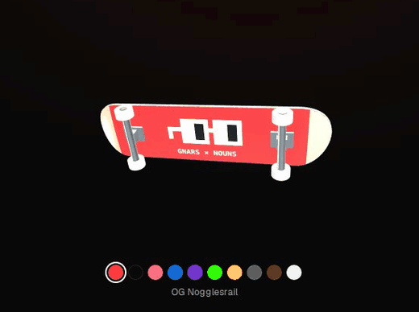
  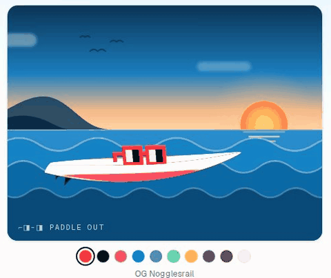
</p>

Gnars DAO funds [Noggles Rails](https://www.gnars.com/nogglesrails): Nouns-shaped skate obstacles installed by local collectives in Rio, Chicago, Nairobi, London, Rome and more. Once a rail is installed, nothing records what happens on it. Trick Log fills that gap, and does the same for the surf side of Gnars:

1. Pick a rail (or a surf spot) on the globe.
2. Film the trick or the wave (or roll the **Noggle Dice** for a challenge).
3. The clip goes to IPFS and the log becomes an **EAS attestation on Base** (place, trick, clip, note).
4. If the place has an open Gnars bounty, the same flow sends a **`createClaim` to the Gnars bounty contract** (PoidhSopa, the one behind gnars.com/community/bounties). Pool contributors vote and the winners get paid as usual.

> The images below come from **demo mode** (`NEXT_PUBLIC_DEMO_MODE=1`), which fills the app with sample skaters, surfers, clips and bounties. The live deployment shows real onchain data only.

## Tour

### Happening now

A live feed of landings, the month's top skaters and the hottest rails of the week. The feed scrolls by itself, counters run up, bars grow, and a prism border follows the cursor.

<p align="center">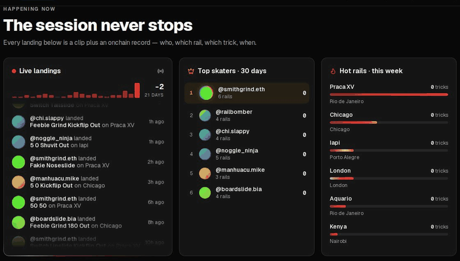</p>

### The globe

The globe is ported from gnars.com. Red rings pulse over the rails with the most logged tricks: the busier the rail, the wider and faster the rings. The effect is tuned in one place, `src/lib/activity.ts`.

<p align="center">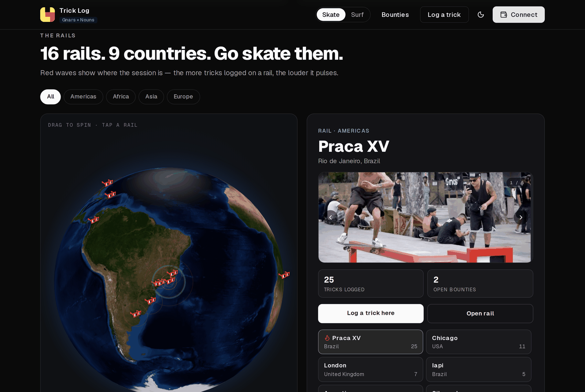</p>

### Rails and spots

Each rail or spot has its own page with its clips, its open bounties, and a **King of the rail** / **Local legend** leaderboard.

| Skate · rail page | Surf · spot page |
|---|---|
| 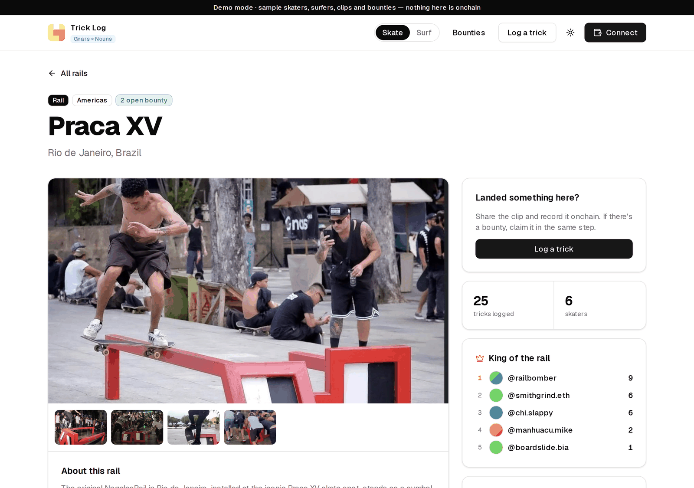 | 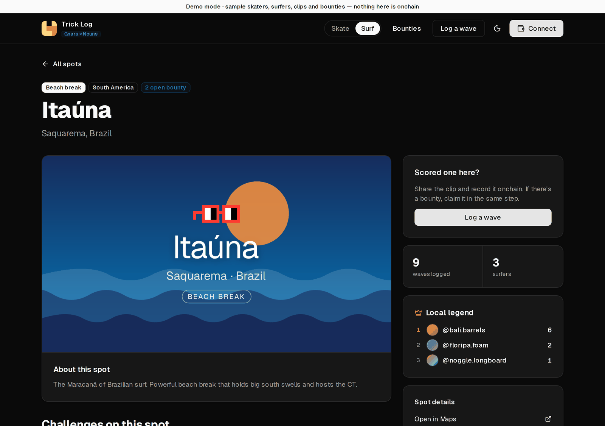 |

### Log it

The log form takes the place, the trick or wave, the clip, a note and an optional bounty. It signs, uploads, attests and claims in one flow.

<p align="center">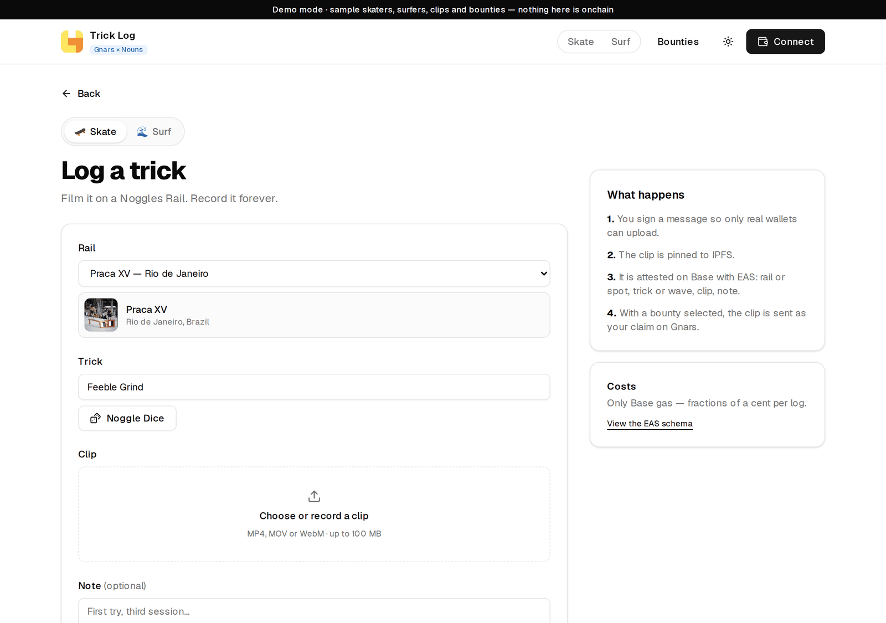</p>

### Skate and Surf, light and dark, on mobile

| Skate | Surf |
|---|---|
| 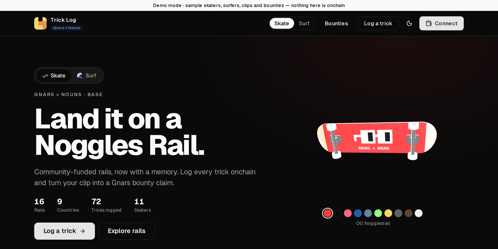 | 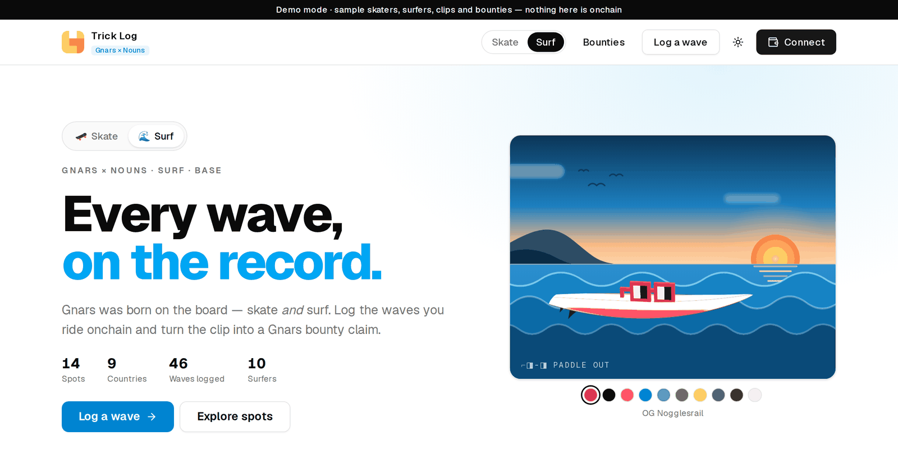 |

<p align="center">
  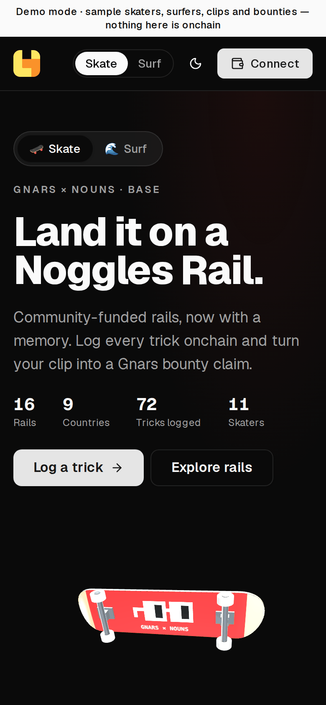
  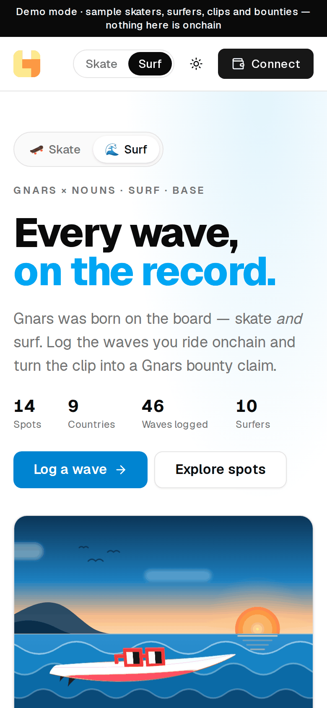
</p>

### Under the hood

- **3D boards built in code.** The skateboard and the surfboard are generated with three.js (`src/components/three/`), so there are no model files to ship and no third-party licenses. Their graphics use the Noggles Rail colorways, which you can pick with the swatches.
- **Surf.** Surf spots take the place of rails. They use the same EAS schema and the same bounty contract, so nothing new has to be deployed. The schema's `rail` field holds the spot slug, and a test makes sure rail and spot slugs never collide. The app starts with 14 well-known breaks (Saquarema, Arpoador, Pipeline, Nazaré…); these are *not* Gnars installations. To add a spot, add one entry to `src/lib/surf-spots.ts`. Spots have no photo library yet, so each one gets a generated poster at `/surf/<slug>/cover.png`. Adding another sport means one entry in `src/lib/sports.ts` plus its places.
- **Theme.** Light, dark and system theme, the same as gnars.com.

## How it helps Gnars and Nouns

- **Proof for "cash for tricks"**: rail activations pay skaters for tricks. With Trick Log every paid trick has a clip, a wallet and an onchain record, and the payout runs through the bounty pool's vote.
- **Usage data for governance**: tricks, skaters and clips per rail give the DAO real evidence for propdates and for proposals to fund the *next* rail.
- **Bounties without new contracts**: any Gnars bounty becomes a rail challenge by adding a tag. Claims sent from here show up on gnars.com automatically.
- **Nouns on the street**: every log is a ⌐◨-◨ obstacle getting skated. It's CC0 culture showing up in real-world use, and the records are public goods on Base.

## Rail bounty convention

Put tags anywhere in a Gnars bounty's title or description:

| Tag | Meaning |
|---|---|
| `rail:<slug>` | Challenge on one rail (slug from gnars.com/nogglesrails/`<slug>`) |
| `rail:any` | Challenge valid on every Noggles Rail |
| `surf:<slug>` | Surf challenge at one spot (slug from `/surf/<slug>`) |
| `surf:any` | Surf challenge valid at every spot |
| `trick:<name>` | Optional, pins the trick or maneuver, with dashes for spaces: `trick:bs-feeble-grind` |

Example: *"Best feeble on the Rio rail wins — rail:rio-de-janeiro trick:feeble-grind"*.

Claims sent from Trick Log carry `rail:`, `trick:` and `attestation:<uid>` in their description. That links each claim back to its onchain log.

## Onchain pieces

| What | Where |
|---|---|
| Trick log | EAS on Base, schema `string rail,string trick,string clip,string note` (revocable, no resolver) → UID `0x0ca8430e94a76662381ecfbed8df1683c267a8ac709a6d7e029fff678b2d9436` |
| Bounties / claims | PoidhSopa `0x31d0A0D4EBE4173f18CBA521882B4C7Cf658F505` (Base) |
| Rails | Same dataset as gnars.com/nogglesrails (`src/lib/rails-data.ts`, from the Gnars website) |

The schema UID is deterministic. Register it once at [base.easscan.org/schema/create](https://base.easscan.org/schema/create) with the exact schema string above, **no resolver** and **revocable = yes**.

## Run it

```bash
pnpm install
cp .env.example .env.local   # add PINATA_JWT
pnpm dev
```

To see the app full of sample data before anyone has logged anything, set `NEXT_PUBLIC_DEMO_MODE=1` in `.env.local`. A banner marks the page as sample data, and the log form simulates the flow without a wallet, an upload or a transaction.

Clip uploads go browser → Pinata through a one-off signed URL. The wallet signs the upload request first, and smart wallets are supported through ERC-1271/6492 verification. Clip URLs use a gateway that gnars.com already renders inline (`ipfs.skatehive.app` by default).

```bash
pnpm test        # unit tests
pnpm typecheck
pnpm lint
```

Stack: Next.js 16 (App Router, Cache Components), wagmi + viem, Farcaster mini app SDK, react-globe.gl, three.js / react-three-fiber, next-themes, Tailwind 4. The UI follows the Gnars website design tokens.

## Credits

- Noggle Dice mechanics adapted from [Skatehive](https://github.com/SkateHive/skatehive3.0)'s skate dice (MIT © sktbrd).
- Rails data, photos, the Noggles Rail colorways, the globe and UI patterns: [Gnars DAO website](https://www.gnars.com). Bounty contract: PoidhSopa.
- ⌐◨-◨ Noggles: [Nouns](https://nouns.wtf), CC0.

## License

MIT
